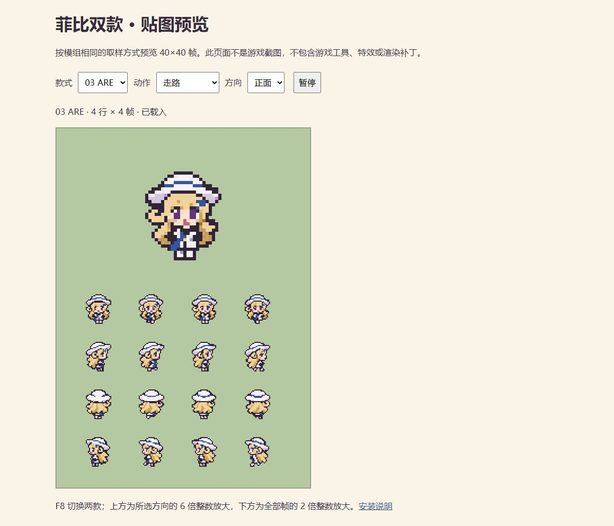
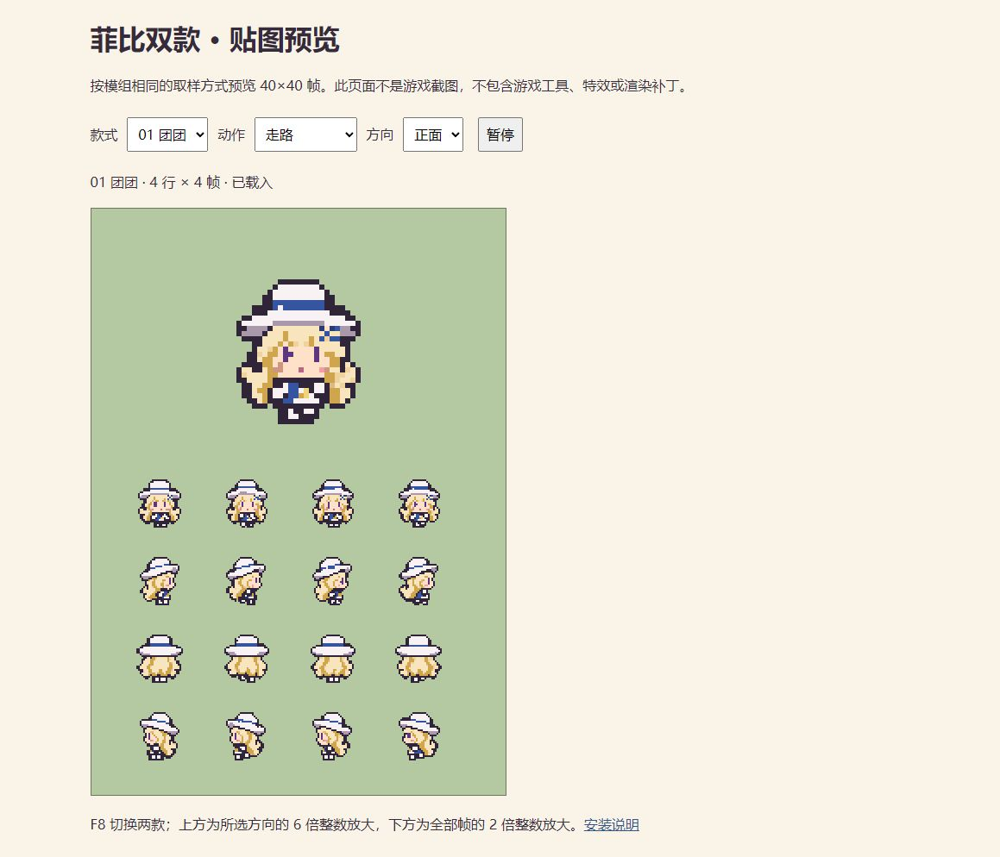

# 菲比双形态玩家模组 · Phoebe Farmer

将《星露谷物语》的玩家外观替换为菲比，并在 **03 ARE 款**与 **01 团团款**之间切换。
基于 [Darian 的 Whale Farmer](https://github.com/Darianliu23/stardew-deepseek-whale-maid-player-sprite) 改造。

**0.1.0 是待实机验收的预发布版本。** 使用公开参考程序集编译；开发机器没有安装游戏。
编译通过不代表已验证实际游戏中的动画、工具对位或模组兼容性。

## 安装

1. 准备 PC 版 Stardew Valley **1.6.15** 和 **SMAPI 4.4.0 或更新版本**。
2. 从本仓库 Releases 下载 `PhoebeFarmer-0.1.0.zip`。
3. 将 ZIP 内的 `PhoebeFarmer` 文件夹解压到游戏的 `Mods` 目录。
   路径应为 `Mods/PhoebeFarmer/manifest.json`，不要再多套一层文件夹。
4. 通过 SMAPI 启动游戏，进入存档后使用快捷键。

不需要 Content Patcher 或 Fashion Sense。若已安装原版 Whale Farmer，请先停用它，避免重复替换。
卸载时退出游戏，再移走 `Mods/PhoebeFarmer`；模组不修改存档或原游戏素材。

## 切换

- **F8**：03 ARE ↔ 01 团团；若外观已关闭，同时重新启用菲比。
- **F9**：菲比 ↔ 原版农夫。
- 选择写入 `config.json`，下次启动保留。打开菜单、对话或过场时不响应快捷键。

`config.json` 默认值：

```json
{
  "Enabled": true,
  "Variant": "are",
  "SwitchKey": "F8",
  "ToggleKey": "F9",
  "WalkFrameMs": 180,
  "OnlyLocalPlayer": true
}
```

`Variant` 可填 `are` 或 `dumpling`。改键后重启游戏；重复键自动恢复为 F8 / F9。
只在本机显示替换；默认只替换自己的角色，联机其他人需要自行安装才能看到。

## 两款预览

以下是重绘素材按 40×40 帧显示的网页预览，不是游戏截图；工具由游戏绘制。

### 03 ARE 款


### 01 团团款


## 动作与限制

两款各包含七张透明姿态表：四向走路、挥重工具、挥武器、蹲下/浇水、钓鱼、吃喝和坐下/表情。
贴图已按小尺寸像素造型重绘。加载时按 `frames.json` 的逐帧边界提取角色，
保留主色块并归一到 40×40 像素帧，脚底对齐；站立角色高约 28 像素。
取样不使用颜色平均混合，避免五官与描边混成灰色。
静态动作由原版农夫帧号驱动，走路使用四帧循环。

- AI 生成姿态可能有细节漂移；未承诺逐帧手工像素精修。
- 左向动作沿用上游的右向镜像，蓝色披带和发饰在这些动作里也会翻转；走路有独立左向帧。
- 原版工具、鱼竿与新的短手臂可能错位，需实机校准。
- 帽子、衣服、发型、配饰属于整套替换，不显示原版装扮。
- Fashion Sense 等同样接管农夫绘制的模组可能冲突。
- 游泳使用上半身裁切，少数剧情姿态使用最近动作/站立回退。
- 缺少动作表时回退到站立；两款都缺少走路表时不启用绘制补丁。

## 从源码编译

需要 .NET 8 SDK、Git、PowerShell。没有游戏也可编译：

```powershell
./build.ps1
```

脚本获取公开的编译专用参考程序集，运行无图形环境的几何/切换检查，编译并输出 `dist/PhoebeFarmer-0.1.0.zip`。
参考程序集仅用于编译，不可用于运行游戏，也不会打入安装包。
已有游戏和 SMAPI 时可指定：

```powershell
./build.ps1 -GamePath 'D:/Games/Stardew Valley'
```

素材只读检查（需 Python 和 Pillow）：

```powershell
python tests/check_assets.py
```

修改素材后运行 `python tests/check_assets.py --write-layout` 更新逐帧边界。
本地动画预览：在仓库根目录运行 `python -m http.server 8765 --bind 127.0.0.1`，
浏览器打开 `http://127.0.0.1:8765/preview.html`。预览使用整数倍显示，避免网页缩放插值。
这里可以检查像素清晰度和帧顺序，不能验证 SMAPI 补丁或游戏工具对位。

## 验收清单

打包前检查编译、切换循环、40×40 帧边界、透明背景、非空帧和 ZIP 内容。
仍需在游戏中检查：F8/F9、重启后选择保持、四向走路、工具挥动/浇水/钓鱼/吃喝、菜单头像、骑马和游泳。
发现问题时请保留 SMAPI 日志、游戏/SMAPI 版本、款式及动作方向。

## 署名与许可

本项目为非官方粉丝作品，代码和图像由 AI 辅助制作。
来源、原作者及素材边界见 [CREDITS.md](CREDITS.md)；代码沿用 MIT 许可，角色图片仅供个人非商业粉丝使用。
